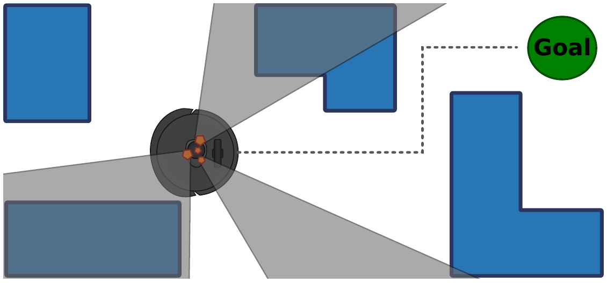
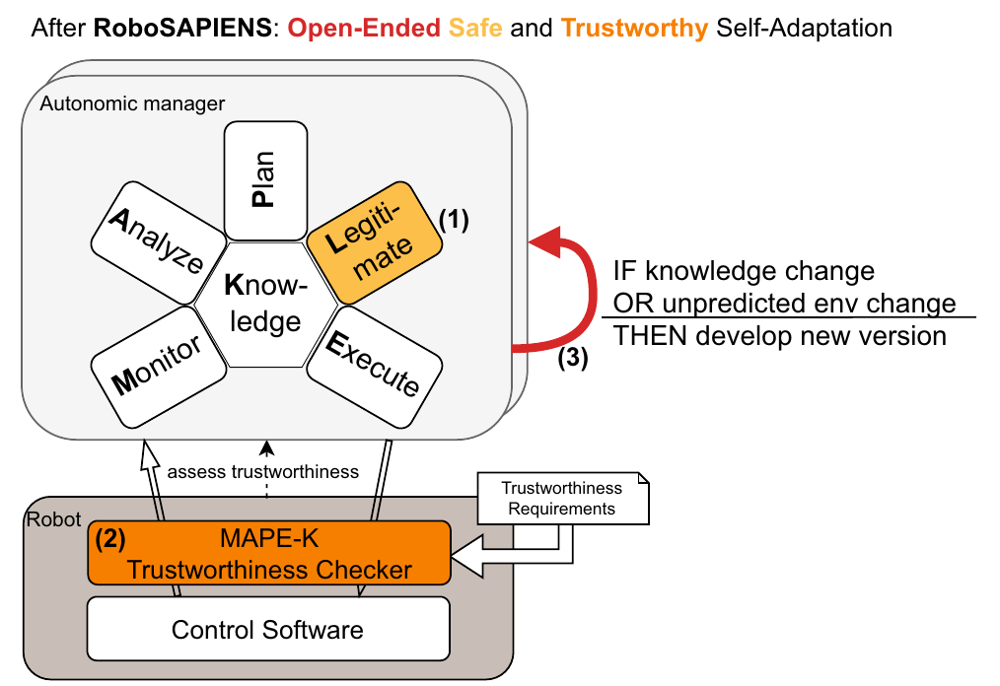
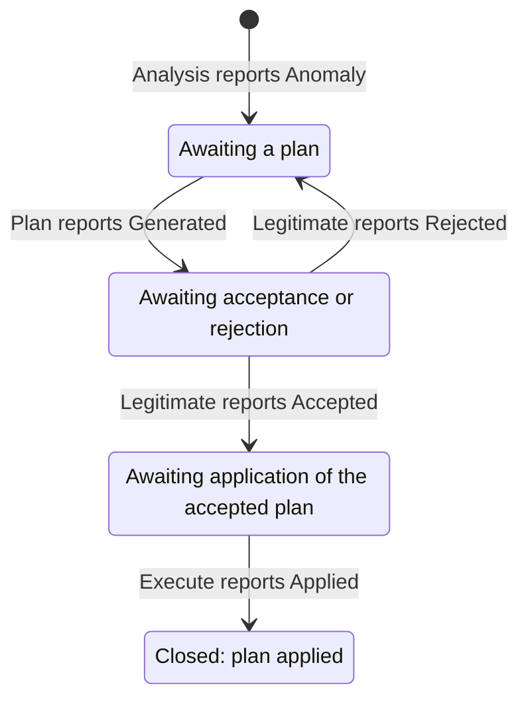
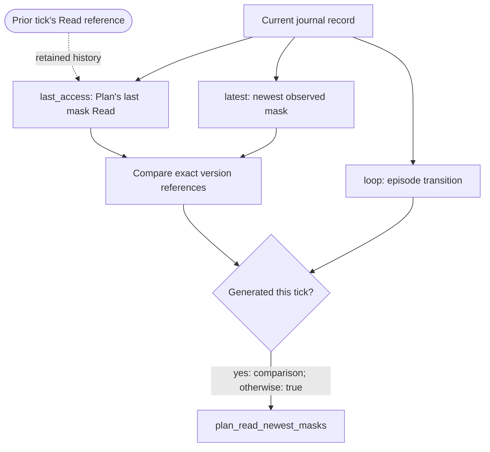
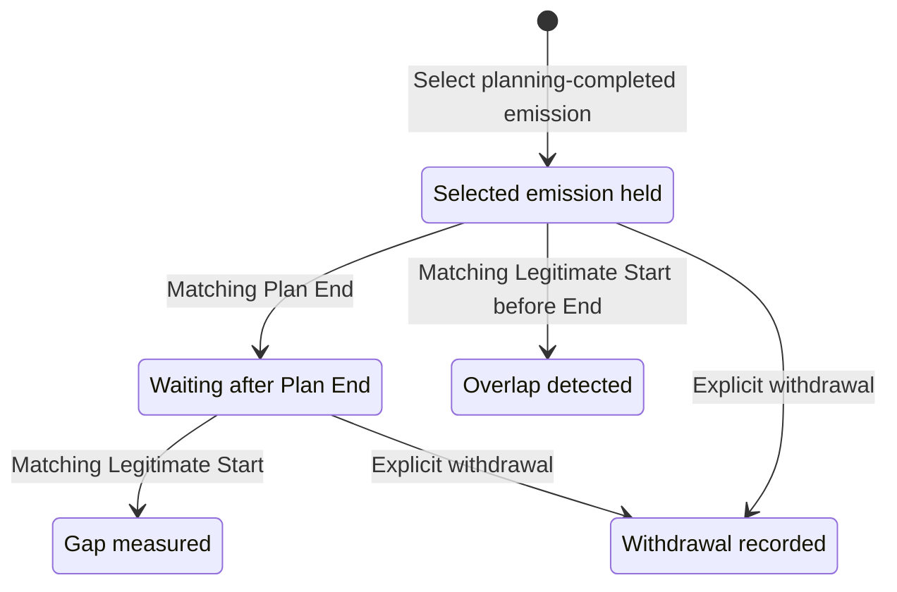

# Monitor a TurtleBot's MAPLE-K loop

Suppose a mobile robot is navigating around obstacles when part of its LiDAR
becomes obstructed. Its navigation software can continue receiving scans, but
some directions are no longer observed reliably. The adaptation loop must
recognise that change, propose a response, check the response, and apply it.
As the case-study owner, you need to know whether those decisions used the
right evidence and whether the adaptation progressed as intended.

The scenario comes from Baxter et al.,
[“Formal Architectural Patterns for Adaptive Robotic Software” (FASE 2025)](https://doi.org/10.1007/978-3-031-90900-9_8),
Section 7. The TurtleBot 4 handles LiDAR occlusion by adding spin commands that
allow it to observe otherwise hidden regions while navigating.



**The adaptation problem.** The grey sectors in the paper's Figure 12 show
occluded directions. Turning the robot changes which parts of the environment
its unobstructed sensor directions can observe. A plausible response still
needs checks: was it based on the current mask, was it accepted, and did the
controller install the accepted commands?

You will use the Trustworthiness Checker (TC) and `rpio::journal::view::maplek` to specify
properties of this loop, run them against an observation journal, and examine
counterexamples. The TC reports what the recorded evidence supports; it does
not control the robot. The examples use one sequential loop and one run.

The journals are synthetic traces. Their schema, acknowledgements,
and example budgets are choices for this tutorial, rather than requirements
or measurements from the paper. Choose the corresponding evidence and limits
for your deployment. The [library feature guide](../features/maplek.md)
describes the available interfaces and their limits.

## Place the checker in the RoboSAPIENS architecture

The project architecture separates proposing an adaptation, legitimating it,
and checking its observed behaviour at runtime. Legitimate asks whether a
proposed plan meets the application's validation and verification criteria.
The TC evaluates properties of the evidence supplied by the loop and the
managed robot, including whether that validation was used as required.



**The project architecture.** Figure 2 from
[Larsen et al., “Robotic safe adaptation in unprecedented situations: the RoboSAPIENS project” (2024)](https://doi.org/10.1017/cbp.2024.4).
The numbered additions are (1) Legitimate, (2) the runtime trustworthiness
checker, and (3) support for continued adaptation.

For the TurtleBot, a Legitimate result might say “this spin plan is accepted”.
The TC can separately ask “was the accepted plan within the chosen limits?”
and “did Execute apply that exact plan?”. These checks require observations
of decisions and effects. They do not cause the robot to turn or establish
physical safety from a phase name alone.

## Decide what the adaptation must establish

Start with the evidence each phase should contribute:

| TurtleBot phase | Application evidence | Question for the monitor |
|---|---|---|
| Monitor | LiDAR scans and a notification to Analysis | Did the Monitor invocation wake the Analysis invocation? |
| Analysis | A mask identifying occluded directions | Does the reported anomaly have supporting evidence? |
| Plan | A sequence of spin commands | Did the planner use the required mask version? |
| Legitimate | Acceptance or rejection | Does an accepted plan meet the chosen motion limits? |
| Execute | An acknowledgement of the applied configuration | Did execution follow acceptance and apply the same commands? |

For example, the planner may propose a spin that is too fast. Rejecting it and
trying a slower plan is normal adaptation behaviour. Executing it despite the
rejection is a different event, which should fail an authorisation property.
Likewise, successfully delivering a command does not establish that the robot
applied it or that its LiDAR coverage improved.

The examples keep those questions separate. They cover causal order, decision
evidence, Knowledge freshness and provenance, plan constraints, execution
integrity, progress, and timing. Each Boolean output is named for the
requirement it checks and is true while that requirement holds; other outputs
name a state, such as whether an adaptation is in progress. You can inspect
them or route them to your own response policy.

One invocation of a phase is an **activation**. A Monitor activation may store
a scan and emit a notification that wakes an Analysis activation. That causal
link identifies the invocations belonging to the same cycle. It does not, by
itself, prove that Analysis read the particular scan Monitor stored; a property
about that data relationship must compare the scan version references.

In the successful trace, Analysis reports the mask
`[false, true, true, false]`: two of four sampled directions are occluded.
Plan proposes a command at `0.4 rad/s` for `8 seconds`. Legitimate accepts it,
and Execute reports that the same command sequence was installed. That gives
us a concrete adaptation to check, while leaving subsequent robot motion and
sensor coverage as separate observations.

An **adaptation episode** begins when Analysis reports an anomaly and ends
when the loop reports a resolution. It can contain several planning attempts.
The diagram shows the path to an applied plan and the retry after rejection.
Each box names the evidence still needed, rather than the callback currently
running.



**Reading rule.** Follow the downward path for an accepted and applied plan.
The return arrow is replanning: rejection removes the held plan, but keeps
the same episode open. The next proposal must be accepted before it can be
applied. Arrows represent recorded outcomes; `loop` also checks their causal
identities and plan version references.

An episode can also close without applying a plan:

| Closing outcome | When it occurs | Meaning in this tutorial |
|---|---|---|
| `NoPlan` | Plan reports that it found no plan. | The anomaly was not resolved by an applied plan. |
| `NotApplied` | Execute reports that the accepted plan was not applied. | Acceptance did not lead to application. |
| `Aborted` | An activation belonging to the active episode aborts. | The episode stops before application. |

These are closing outcomes, not extra planning retries. The tutorial's
`episode_closes_applied` requires `Applied`; another application may permit a
safe abort.
A normal cycle in which Analysis reports no anomaly opens no episode.

Two kinds of temporal question recur below. A **decision check** asks whether
an observed decision is allowed—for example, whether an accepted spin stays
within the motion limits. It fails at that decision. A **response obligation**
opens when something needs a later resolution—for example, an anomaly
waiting for application, or a service request waiting for completion. Its
pending state, how it ended, and its deadline must be inspected together.

A true conditional check on an unrelated tick does not mean the obligation
was resolved. The timeline diagrams show selected decision ticks explicitly,
and label whether their horizontal axis is journal time or logical ticks.
Use a diagram's **Full screen** control when you need to inspect its labels
at a larger size.

## Describe the TurtleBot's domain evidence

The built-in libraries describe the structure of an observed loop.
`rpio::journal` supplies records, phase roles, activation identities, and
Knowledge version references. The application's explicit adapter supplies
messages, processing positions and clock labels to `rpio::journal::view`.
`rpio::journal::view::maplek` reconstructs cycles and adaptation episodes;
`rpio::journal::view::timing` tracks callbacks, requests, and handoffs.
Those libraries do not define what a LiDAR mask or a spin command contains.

The local module `examples/turtlebot-maplek/turtlebot.dsrv` supplies those
application types. It describes the evidence your monitor receives, rather
than implementing the robot's planner, sensor processing, or Knowledge store.
For your own case study, replace this domain module while retaining the
built-in loop and journal libraries.

Start by defining the values stored in the loop's Knowledge:

```dsrv
{{#include ../../../examples/turtlebot-maplek/turtlebot.dsrv:domain_types}}
```

`Knowledge` is the application's tagged union: each variant identifies a
kind of recorded value and its payload. Each payload is a struct of declared
fields; the journal records a value as plain JSON, and the replay source
reads every recorded value against the declared type of its key. A record
that reads, writes or cites a value carries that immutable version of it.

| Knowledge variant | Domain meaning | Property it supports |
|---|---|---|
| `LidarScans` | Range samples supplied by Monitor. | Relating an analysis decision to sensor evidence. |
| `BoolLidarMasks` | Directions reported as occluded by Analysis. | Anomaly evidence and the version used by Plan. |
| `Directions` | The proposed sequence of spin commands. | Acceptance constraints and matching the applied commands. |
| `VerificationInfo` | The recorded acceptance decision. | Checking the evidence accompanying acceptance. |
| `SpinConfig` | The configuration reported as installed. | Comparing the execution effect with the accepted plan. |

Here a `true` mask entry means an occluded angular sector. `LidarScans`
contains simplified range samples; the tutorial does not implement an
occlusion detector. It uses Boolean masks and omits probabilistic masks.
`VerificationInfo` records the reported acceptance decision, and `SpinConfig`
is the reported execution effect. Your producer must provide evidence with
these meanings; the checker cannot infer them from an event name.

Next, describe the messages the callbacks publish and receive, then
specialise the built-in journal record type:

```dsrv
{{#include ../../../examples/turtlebot-maplek/turtlebot.dsrv:journal_types}}
```

`Emitted` is the message a callback publishes: here it names the stage it
completes. `Trigger` is the message an invocation receives at Start: a LiDAR
update, which names no stage, or the message its predecessor published. Each
record also names its topic. These message types are separate from the
journal's emission identities, which establish which invocation caused the
next one.

`Record = view::Record<Knowledge, Emitted, Trigger>` combines the generic
journal structure with the three application types. You do not redefine
Monitor, Plan, Read, End, or the versioning protocol in the domain module.
Each record carries the exact Knowledge versions it reads, writes or cites,
with their values and writers, so a decision's evidence is the version it
actually used. Each activation also names the emission that caused it.

`JournalTime` names a time domain: the time of the clock that admits records
to the journal. Every time the monitor sees is a
`std::time::Instant<JournalTime>`, and every budget a
`std::time::Duration<JournalTime>`. Declaring it with `newtype` makes it a
type of its own, so an instant from another clock cannot be compared with it
by mistake. `ViewObservation` is the adapter’s property input on
each tick: the current record with its journal time, or `None`, and a clock
sample, or `None`. The library's stream functions read the observation, so a tick
without a record never repeats the last one.

Finally, give the monitor a way to select masks from the Knowledge union:

```dsrv
{{#include ../../../examples/turtlebot-maplek/turtlebot.dsrv:mask_projection}}
```

`masks` returns `Some(value)` for a mask and `None` for every other variant.
Passing this selector to `latest` or `last_access` lets a property
retain the relevant domain value. The selector should identify one Knowledge
key; it does not perform anomaly detection or decide whether a mask is fresh.

## Run the checks against one adaptation

The first part of `examples/turtlebot-maplek/properties.dsrv` declares the
input and instantiates the loop:

```dsrv
{{#include ../../../examples/turtlebot-maplek/properties.dsrv:setup}}
```

`use experimental::high_level_dsrv` enables the extended DSRV notation,
including local stream functions. Use that declaration in each application module;
imports do not transfer a caller's language settings to another module.

`mod turtlebot` loads the adjacent `turtlebot.dsrv` file, and
`use turtlebot::*` imports its public names. The example uses those names
directly, so it does not need a separate `use turtlebot` namespace import.

In DSRV, `in` declares evidence supplied to the spec, `aux` names an
intermediate calculation, and `out` exposes a result. The configuration replays
the journal through the
[RPIO observation source](../reference/input-configuration.md#rpio-observation-journals)
without clock samples, so each journal record causes one evaluation, called
a tick. `record` is that tick's record, for the record patterns below. The
`loop` function retains state between ticks; each use creates an independent
instance. If you are new to
the notation, the [DSRV tutorial](write-dsrv-monitor.md) explains its stream
equations and history operators.

`loop` reconstructs a cycle and an adaptation episode from the journal. The
cycle begins when Monitor starts; the episode begins when Analysis reports
an anomaly at its End. Subsequent activations join through causal links, and
episode transitions also match the relevant plan version references.
`adaptation_in_progress` tells you whether the anomaly is still being handled.

`protocol_followed` checks the transitions recognised by those two reconstructions.
It does not verify every record or require every callback to have an End.
For example, omitting Monitor End need not make it false. Use callback and
handoff properties below when complete Start/End pairing or non-overlap is
part of your requirement.

Run the complete spec, which includes the properties developed below, from
the repository root. You need Rust/Cargo and the checked-in files; default
features suffice, with no ROS, broker, simulator, or robot required.

```sh
cargo run --quiet --bin trustworthiness_checker -- \
  examples/turtlebot-maplek/properties.dsrv \
  --input-config examples/turtlebot-maplek/accepted-input.json5 \
  --output-stdout --runtime dataflow --semantics typed-untimed
```

The configuration reads `examples/turtlebot-maplek/native/accepted.jsonl` with
a frozen 32-record extent, SHA-256 digest and `turtlebot.journal` clock label.
Six immutable Knowledge commits precede their phase Write facts; Read and End
facts name those exact versions. The adjacent native manifest maps the 26
archived semantic records to their new physical record indices. This trace
records an anomaly, one accepted plan, successful service delivery, and a matching execution effect.
Selected stdout lines are:

```text
protocol_followed[0] = true
adaptation_in_progress[31] = false
plans_applied[31] = 1
adaptation_requirements_held[31] = true
```

The replay produces ticks 0 through 31 and exits. Tick indices count records;
they are not seconds. Output order across streams
is not significant. You can also use `--runtime semi-sync` and either
`typed-untimed` or `gradual-typed-untimed` semantics. The specs use the
`high_level_dsrv` setting shown above; see [language settings](../reference/dsrv-language-settings.md).

## Check the evidence supporting the anomaly

**Requirement: open an adaptation only when the reported mask contains an
occluded sector.** In the teaching mask `[false, true, true, false]`, adaptation
has supporting evidence because two entries are true. With
`[false, false, false, false]`, reporting the same anomaly is inconsistent with
the supplied evidence. The TC should expose that inconsistency before you
interpret the subsequent plan as a justified response.

`anomaly_has_occlusion` is checked when Analysis's anomaly opens the episode.
The nested folds calculate “at least one true entry in at least one mask”.
They do not count phase transitions or trust the `Anomaly` label as proof.

An incomplete record, a new run mixed into the trace, or backwards phase
timestamps makes the intended interpretation questionable. Use `tick` to
expose those conditions, and inspect the anomaly's actual evidence:

```dsrv
{{#include ../../../examples/turtlebot-maplek/properties.dsrv:evidence}}
```

The `match` expressions select the evidence to inspect. Most checks in this
spec are conditional: they return true on ticks where their decision is not
being evaluated. Interpret them alongside the transition and pending-state
outputs, rather than treating each true value as a new successful adaptation.

`run_unchanged` permits the first phase's run announcement but is false on a
later run change. It does not reset `loop`. `phase_times_ordered` compares successive
phase arrival times; it does not use time to establish causal membership.
Neither can detect a record a producer silently omitted. The finite tutorial
capture's frozen extent and digest reject deletion, truncation or editing before
evaluation. Native Redis stream cursors are opaque; they do not establish a
numeric global gap proof.

`anomaly_has_occlusion` requires at least one occluded sector when an episode
opens. On other ticks it returns true because that question is not being
evaluated. This checks the supplied mask against the reported anomaly. It
does not prove the mask accurately describes the sensor or the world.

## Check the Knowledge used to generate a plan

**Requirement: generate a plan using the newest observed mask version, and
attribute that plan to the planner invocation that produced it.** A mask
update can change the response needed to observe blind regions. A missing read
leaves the decision unsupported; a stale read means the decision missed
newer evidence. An unexpected writer raises a separate provenance question.

The monitor calculates this from three streams of evidence:



**Reading rule.** Solid arrows are dependencies between stream calculations,
not messages sent between robot components. The dashed arrow represents
retained history. Many journal records can arrive between the Plan Read and
plan generation; retaining that reference lets the checker compare the actual
read with the newest observed version at the decision tick.

Here is the DSRV implementation. `plan_read_newest_masks` checks versions,
`plan_read_current_mask_values` checks payloads, and `plan_written_by_planner`
checks provenance:

<details>
<summary>DSRV: retain the read and compare it at plan generation</summary>

```dsrv
{{#include ../../../examples/turtlebot-maplek/properties.dsrv:knowledge_use}}
```

</details>

`rpio::journal::view::knowledge::last_access` retains the mask version of Plan's last selected Read, with its
reference, value, and writer, and clears it when the next Plan activation
starts. `rpio::journal::view::knowledge::latest` supplies the newest mask observed
through phase writes and external Knowledge commits, with its version reference. On `Generated`,
`plan_read_newest_masks` requires that Read to exist and to name exactly the
newest version. Freshness in this example means current **when the plan is
generated**, including any newer evidence observed after its last Read.

`plan_read_current_mask_values` compares payloads instead. That alone would
accept an older version with identical content, which is why the version
check is the freshness requirement.

The `same-value-update` timeline makes the difference visible. Here,
`v3` and `v4` abbreviate full version references with the same store epoch and
mask key, but write sequences 3 and 4:

{{#include ../assets/user/turtlebot-maplek/freshness-trace.svg}}

**Reading rule.** Columns show selected journal ticks 14–19, including the
external Knowledge commit. The upper two rows show retained references at each tick; the verdict row has a result only
at plan generation. Plan reads v3 at tick 14. Another writer stores v4 at
tick 15, so the newest observed reference changes while the recorded Read
remains v3. Empty verdict positions are not additional successful decisions.

At tick 19, `plan_read_current_mask_values` is true: the lists of Booleans
are equal. `plan_read_newest_masks` is false: Plan did not record a Read of
v4. This is why
a value comparison cannot enforce the chosen freshness requirement.

`plan_written_by_planner` checks the writer of the generated plan against its producing
activation and run. Writer metadata is supplied by the journal; checking it
does not independently authenticate the producer.

“Newest” here means newest **recorded write or read the monitor has seen**,
including writes outside any activation. An unrelated Knowledge write does
not establish that planning observed it. The single-key helpers follow Reads,
Writes and Knowledge records; inspect the explicit outcome fields when an End
cites both a plan and a verification result.

For stronger requirements, retain version references for every required input
and relate them to the anomaly and plan. For example, checking that planning
and legitimation used the same mask needs their exact read evidence. A single
retained value does not establish that relationship automatically.

## Check what is allowed to pass legitimation

**Requirement: an accepted plan contains a turn and stays within the chosen
motion limits.** Consider two proposals: `0.4 rad/s` for `8 seconds` and
`0.8 rad/s` for `8 seconds`. Under the policy below, the first is within the
limits; the second must not be accepted. Rejecting the second and proposing
a replacement is an allowed response.

For teaching purposes, treat angular velocity as radians per second and
duration as seconds: every accepted spin
command must have `abs(angleVelocity) <= 0.5` and `0 < duration <= 10.0`.
The command list must be nonempty and include at least one nonzero turn.

```dsrv
{{#include ../../../examples/turtlebot-maplek/properties.dsrv:acceptance}}
```

The property uses the plan held **before** the acceptance transition and the
verification result carried by that transition. The library has already
matched that transition to the held plan version and its causal activation.
The spec then checks the content rather than trusting the acceptance tag.

A plan exceeding these limits may be proposed and rejected without violating
`accepted_plan_within_limits`. An accepted plan exceeding them fails. This is a property
about what is allowed to pass legitimation; it does not require every planning
attempt to succeed.

Command bounds are only one application constraint. To check that spins make
all occluded regions observable, add a geometrical predicate using the mask,
sensor field of view, and command sequence. To check collision avoidance, add
the corresponding environmental evidence. The library supplies causal state
and data access; it does not provide those TurtleBot-specific predicates.

The nonzero-turn condition excludes a plan that merely waits, but a small turn
can still leave a blind region unobserved. These checks establish the chosen
motion envelope and basic plausibility, rather than full recovery or safety.

## Check authorisation and the applied configuration

**Requirement: Execute starts because this plan was accepted, and reports
installing the same commands.** These are two checks at different moments.
Suppose Plan emits a proposal and Execute starts immediately: even if it
later installs the proposed commands, it skipped the required acceptance.
Conversely, starting after acceptance is insufficient if Execute installs a
different angular velocity.

| Observation | Question | Output |
|---|---|---|
| Execute Start | Does this Start name the accepting activation as its cause? | `execution_authorised` |
| Applied outcome | Do its command list and accepted plan agree, with a positive configuration period? | `applied_config_matches_plan` |

The `wrong-effect` trace separates delivery evidence from effect evidence:

{{#include ../assets/user/turtlebot-maplek/wrong-effect-trace.svg}}

**Reading rule.** Columns show selected journal ticks 24–31. The accepted
plan remains `0.4 rad/s`. Successful delivery at tick 28 does not settle the
effect check; the `Applied` outcome at tick 31 cites commands at `0.2 rad/s`,
so `applied_config_matches_plan` fails. Both command durations are eight seconds.
Blank event and verdict cells mean that observation did not occur on that
tick; they do not mean the service or the property failed.

Check execution when it starts, as well as the outcome it eventually reports:

```dsrv
{{#include ../../../examples/turtlebot-maplek/properties.dsrv:execution}}
```

`execution_authorised` requires a held acceptance and a Start caused by the
accepting activation. Waiting until Execute End would allow an unauthorised
Start to go unnoticed for the entire callback.

`applied_config_matches_plan` compares the reported applied command sequence to the
held plan and requires a positive configuration period. The episode layer
also checks that the execution outcome names the accepted plan version.
The tutorial leaves the unit of `period` unspecified and checks only its
positivity.

These properties are complementary. An execution may follow the right causal
chain and still apply the wrong configuration. A matching configuration may
be reported even though execution started without acceptance. `plans_applied`
records that an application outcome was actually observed; otherwise a trace
with no execution could satisfy the conditional data checks vacuously.

The synthetic acknowledgement establishes only the recorded configuration.
Physical motion and restored visibility need further managed-system and sensor
observations. A delivered command, an `Applied` outcome, and successful
navigation are distinct claims.

## Check progress, retries, and adaptation time

**Requirement: resolve the anomaly within the chosen retry and time budgets.**
Replanning can be legitimate progress, but repeated rejection can keep the
robot adapting indefinitely. A counter bounds the number of rejected
proposals; an episode budget bounds total observed adaptation time, including
retries. The required closure specifies what counts as resolving the anomaly.

This spec allows one rejected plan per episode and requires an `Applied`
closure. It uses two seconds for a planning outcome, one each for validation
and execution outcomes, and five for the whole episode. These are teaching
limits for acknowledging configuration changes.

The plotted traces show why the interval's opening event matters:

{{#include ../assets/user/turtlebot-maplek/planning-traces.svg}}

**Reading rule.** Horizontal position is the supplied journal time in seconds,
not the record index or CPU time. Solid spans run between the named opening
and closing observations; a dashed mark is that obligation's deadline. Both
traces have a 0.4-second Plan callback. In the slow trace, the 3-second wait
before Plan starts makes the planning outcome take 3.5 seconds, so it exceeds
the 2-second budget. A callback-only check would miss that delay.

The spec records these counters, spans, and predicates:

<details>
<summary>DSRV: retry counts, timing budgets, and the accumulated result</summary>

```dsrv
{{#include ../../../examples/turtlebot-maplek/properties.dsrv:progress}}
```

</details>

The rejection counter resets on `Opened`. A rejection clears the held plan,
and the next planning attempt must fit the episode's causal evidence. A
replacement plan still needs acceptance before execution. For this tutorial,
even a fallback plan follows that explicit path; map a differently implemented
fallback through an application-specific observation policy.

`episode_closes_applied` treats `NoPlan`, `NotApplied`, and `Aborted` as failures. That is
a deliberately chosen requirement, not a universal MAPLE-K rule: a safe abort
may be the correct response in your application.

Here execution ends when the installed configuration is acknowledged. Its
one-second budget does not require the eight-second spin to finish within one
second. To bound physical recovery time, add an obligation ending at the
managed-system or sensor observation that demonstrates recovery.

The budgets are typed constants, such as
`const planning_budget: Duration<JournalTime> = std::time::seconds(2.0)`, so a
budget in another time domain is a type error. The spans describe state
before the current phase record. A record completing planning still exposes
its planning duration. Each `*_on_time` output negates `exceeds`, which uses
strict `>`: exactly two seconds does not exceed the two-second planning limit,
so it is on time. A `None` span exceeds nothing, so it counts as on time; use
state and completeness checks alongside timing.

`role_on_time` adds a budget measured from the held role's Start. This includes
the wait for the successor's Start, even if the predecessor callback has
already ended. Its example limits are one second for each role except Analysis,
which has two. An outcome-stage span, role span, and callback duration can
therefore answer different timing questions about the same phase.

These temporal requirements can be read as “whenever an anomaly opens an
episode, require a permitted resolution within its budget”. The state diagram
shows when the obligation opens, changes, and closes; the plotted trace shows
whether its timing policy holds on a particular run. The DSRV equations
implement those checks over the observed stream. An unfinished finite trace
cannot establish an unbounded “eventually resolves” requirement.

`adaptation_requirements_held` remembers any failure for the rest of the
run. It combines only the requirements in this adaptation spec. Service and
callback requirements belong to the separate lifecycle spec below; they are not included
in this result. A passing value also does not assert that an unfinished
episode will eventually complete. Without clock samples, a silent loop
cannot generate a new timeout observation, and EOF supplies no verdict.

## Explore counterexamples and a normal no-adaptation cycle

Replay an unsafe accepted plan by changing only the input configuration:

```sh
cargo run --quiet --bin trustworthiness_checker -- \
  examples/turtlebot-maplek/properties.dsrv \
  --input-config examples/turtlebot-maplek/unsafe-input.json5 \
  --output-stdout --runtime dataflow --semantics typed-untimed
```

Selected stdout shows the failing acceptance and the remembered result:

```text
accepted_plan_within_limits[24] = false
adaptation_requirements_held[31] = false
```

The checker still exits normally: these Booleans are spec outputs, not process
exit statuses. Inspect or route the outputs to enforce your chosen policy.

For the other experiments, substitute the named configuration in the same
command. Each is in `examples/turtlebot-maplek/`:

| Input configuration | Change in the journal | Observation |
|---|---|---|
| `replanned-input.json5` | Reject the first proposal; accept and apply the replacement. | The accumulated result stays true and `plans_applied` finishes at 1. |
| `nominal-input.json5` | Analysis finds no anomaly and closes the cycle. | The result stays true, `adaptation_in_progress` is false, and `plans_applied` is 0. |
| `false-anomaly-input.json5` | Report an anomaly with an entirely clear mask. | `anomaly_has_occlusion` becomes false. |
| `missing-read-input.json5` | Plan without the required mask Read. | `plan_read_current_mask_values` becomes false. |
| `stale-input.json5` | Read the older of two observed mask versions. | `plan_read_newest_masks` becomes false. |
| `same-value-update-input.json5` | Observe a newer, equal-valued mask after the planner's Read. | `plan_read_newest_masks` fails at plan generation despite matching payloads. |
| `ineffective-input.json5` | Accept commands with zero angular velocity. | `accepted_plan_within_limits` becomes false. |
| `external-plan-input.json5` | Attribute the plan write to another controller. | `plan_written_by_planner` becomes false. |
| `unvalidated-input.json5` | Execute directly after planning. | `execution_authorised` and `protocol_followed` become false. |
| `wrong-effect-input.json5` | Report different applied spin commands. | `applied_config_matches_plan` becomes false. |
| `retry-exhausted-input.json5` | Reject two plans before accepting a third. | `rejections_within_limit` becomes false. |
| `slow-input.json5` | Delay the start of planning by three seconds. | `planning_on_time` becomes false on the next phase observation. |
| `no-plan-input.json5` | Close the episode without finding a plan. | `episode_closes_applied` becomes false. |
| `not-delivered-input.json5` | Report failed command delivery and `NotApplied`. | `episode_closes_applied` becomes false. |
| `pending-service-input.json5` | Stop after starting the command-delivery request. | The accumulated result stays true, but `adaptation_in_progress` stays true and `plans_applied` is 0. |

Compare the nominal and pending-service experiments. Neither reports an
application, but the nominal cycle had no adaptation obligation. The pending
episode still needs a resolution. Each file is one run, so its final
accumulated result applies to that run only.

## Locate delays in callbacks, services, and handoffs

Outcome budgets include waiting between callbacks. To diagnose the source of
a delay, use `rpio::journal::view::timing` with a clock-aware observation. A second
spec, `examples/turtlebot-maplek/lifecycle.dsrv`, begins with:

```dsrv
{{#include ../../../examples/turtlebot-maplek/lifecycle.dsrv:lifecycle_setup}}
```

The native input also receives clock samples when its configuration supplies
them; the adapter preserves those samples in `ViewObservation`. The `budgets` module holds the budgets below as
typed constants; an imported constant keeps its `Duration<JournalTime>` type.

These outputs answer additional questions; they are not folded into
`adaptation_requirements_held`. A loop can report a matching applied
configuration while its service journal contains an overlapping request or
lacks completion evidence. Inspect both sets of outputs if your policy requires both contracts.

### Callback completion

**Requirement: the selected Plan invocation ends within one second, with no
second Plan Start while it is pending.** This diagnoses whether the planner
callback itself is slow. It uses Plan Start and its matching End, rather than
the earlier anomaly that opened the planning obligation. See the two callback
rows in the plotted traces above.

```dsrv
{{#include ../../../examples/turtlebot-maplek/lifecycle.dsrv:callback}}
```

`plan_callback_on_time` measures Plan Start to its matching End, with a
one-second example budget. It is narrower than `loop.timing.plan`, which
starts when an anomaly or rejection is reported.
`plan_callback_single_activation` is false when `overlapping_start` reports a
second opener while one activation is already held; the second does not
replace the first. An End can
close the callback even if the callback aborted, so timing completion is not
adaptation success.

### Service completion and ownership

**Requirement: each `apply_spin` request is delivered, on time, and alone.**
It receives a matching, successful completion within one second, and no
second request starts while it is open. A service response must belong to
this request and this Execute activation. A response from an earlier request
must not discharge the current obligation. If Execute ends without completing
the request, the request is abandoned, and that fails the delivery
requirement even when Execute reports an applied configuration.

The synthetic Execute callback uses a service named `apply_spin_config`:

```dsrv
{{#include ../../../examples/turtlebot-maplek/lifecycle.dsrv:service}}
```

`service_timing` matches the owning activation and request identity, in addition
to the service name. On the tick a request ends, its `ended` field is
`Completed(Delivered)`, `Completed(NotDelivered)`, or `Abandoned`, when the
owning callback ended without completing it. The three requirement outputs
read it as follows:

| Output | True when |
|---|---|
| `apply_spin_on_time` | The open request's age, or a finished request's span, does not exceed `apply_spin_budget`. |
| `apply_spin_single_request` | No request starts while another is open. |
| `apply_spin_delivered` | The request is still open, or it has ended with `Completed(Delivered)`. |

`apply_spin_delivered` is conditional: it is true before the request ends, so
it does not assert that delivery occurred. `apply_spin_ended` reports the
tick on which the request ended, and `apply_spin_pending` whether one is open.

On the completion tick the old request still has a measured span, but is no
longer pending. A late completion of a retired request must not satisfy a
newer request's obligation. Each helper instance tracks one obligation at a
time; `apply_spin_single_request` checks that this bound fits your service
usage.

### Causal handoff and withdrawal

**Requirement: Legitimate starts after the selected Plan invocation ends,
caused by its specific planning-completed emission, within half a second.**
The emission identifies the transfer; the predecessor End opens the measured
gap. Correct causality and sequential execution are separate requirements:
a successor can name the correct emission and still start too early.



**Reading rule.** Arrows are observations that resolve or advance the selected
handoff. The half-second deadline is measured while waiting after Plan End.
A pending wait is not evidence that Legitimate started. The example requires
`Gap`; `Overlap` or `Withdrawn` fails its sequential-success policy. An
application that permits withdrawing an aborted plan can choose a different
policy.

Select the emission that hands a generated plan to Legitimate:

```dsrv
{{#include ../../../examples/turtlebot-maplek/lifecycle.dsrv:handoff}}
```

`handoff` waits for the specified successor, caused by that exact emission.
Its gap begins at the predecessor's matching End, not when the emission is
published. A matching successor Start produces `Gap`; starting before the End
produces `Overlap`. The tutorial requires a sequential handoff, so overlap
fails `handoff_sequential` even if the causal link is correct.
`handoff_on_time` bounds the wait after Plan ends, and
`handoff_single_transfer` is false when a second transfer is selected while
one is still waiting. `handoff_resolved` reports the tick on which the
handoff ended.

The spec also supplies explicit withdrawal evidence when the selected planner
aborts. This produces `Withdrawn` rather than inventing a successor Start or
letting the wait continue forever. The reason and policy are application
choices. The retained transfer is used only when it matches the aborting
activation; ordinary End records do not select a new transfer.

Run this second spec against the same successful adaptation:

```sh
cargo run --quiet --bin trustworthiness_checker -- \
  examples/turtlebot-maplek/lifecycle.dsrv \
  --input-config examples/turtlebot-maplek/accepted-lifecycle-input.json5 \
  --output-stdout --runtime dataflow --semantics typed-untimed
```

Selected stdout is:

```text
plan_callback_ended[18] = true
handoff_resolved[19] = true
handoff_sequential[19] = true
apply_spin_ended[28] = true
apply_spin_delivered[28] = true
```

Substitute `overlap-lifecycle-input.json5`, `withdrawn-lifecycle-input.json5`,
`not-delivered-lifecycle-input.json5`, `owner-ended-lifecycle-input.json5`, or
`service-conflict-lifecycle-input.json5` to observe the respective failing
handoff, failed delivery, abandoned request, or overlapping request. These
lifecycle outputs are per-tick verdicts; accumulate them if your policy
needs to remember a failure after its evidence tick.

For a concrete comparison, `owner-ended-input.json5` and
`service-conflict-input.json5` pass the adaptation spec: their recorded
configuration matches the accepted plan. Their corresponding lifecycle
configurations fail `apply_spin_delivered` and `apply_spin_single_request`,
respectively. Passing the adaptation spec alone does not certify service
completion or request ownership.

## Detect an overdue request during journal silence

**Requirement: a pending configuration request still stops being on time
when the loop stops emitting records.** After Service Start, silence should
not freeze the request's age. This is an obligation over the pending request
and the clock, not a repetition of the last journal event.

Without clock samples a spec cannot observe time passing after its last
input. With them it can. The finite pending-service configuration replays a
prefix and then supplies two clock samples. Each supplies the number of
admitted native records it follows (`through`), including Knowledge commits, and is delivered only after that prefix:

```json5
{{#include ../../../examples/turtlebot-maplek/pending-service-lifecycle-input.json5}}
```

Run it with:

```sh
cargo run --quiet --bin trustworthiness_checker -- \
  examples/turtlebot-maplek/lifecycle.dsrv \
  --input-config examples/turtlebot-maplek/pending-service-lifecycle-input.json5 \
  --output-stdout --runtime dataflow --semantics typed-untimed
```

The request remains open after journal tick 27. The clock-only evaluations
produce these selected lines:

```text
apply_spin_pending[28] = true
apply_spin_on_time[28] = false
apply_spin_pending[29] = true
apply_spin_on_time[29] = false
apply_spin_ended[29] = false
```

{{#include ../assets/user/turtlebot-maplek/silent-service-trace.svg}}

**Reading rule.** Columns are consecutive observation ticks, including two
clock-only ticks after the last journal record. Their supplied times are
shown explicitly: equal tick spacing is not equal elapsed time. The request
ages from zero to 1.8 and 2.8 seconds, exceeding its one-second budget. It
remains pending because no completion or owner End has been observed.

They advance the request's age without replaying its Start. Ages run to
"now", the latest record or clock-sample time so far, which never goes back. Supply clock samples in the same time domain and seconds as journal
timestamps. When a schedule makes a record and a sample one tick, an interval
the record closes still ends at the record's own time. A false `apply_spin_on_time` here
does not close the service request or cancel work on the robot.

The same holds for live input from the `rpio-observation-clock` source with
an explicit positive `clock_period_ms` and `journal_clock: "redis.server.time"`.
It samples Redis TIME and releases a sample only after both stream cursor
frontiers captured with that sample have been covered. Omit the period when
additional clock-only evaluations are not needed. `loop` reads the same
observation: a clock-only tick leaves its cycle and episode as they were, while its outcome spans age, so a
budget on `loop.timing` can also expire during silence.

## Apply the property families to your own loop

| Property family | Reusable evidence | Application decision still required |
|---|---|---|
| Protocol and causality | Cycle/episode transitions, activation identities, emission links | Which loop/run profile is permitted; what an unexpected transition means. |
| Observation and decision evidence | `tick`, record views, `Opened` evidence | Completeness, sensor validity, anomaly criteria, and clock validity. |
| Knowledge use and provenance | `last_access`, `latest`, resolved references and writers | Required keys, acceptable versions, writers, and relationships between decisions. |
| Plan and acceptance constraints | Held plan plus `Accepted`/`Rejected` evidence | Command limits, coverage, collision constraints, and sufficient validation evidence. |
| Execution integrity | Acceptance state, Execute Start, `Closed(Applied(...))` | Allowed execution, matching effects, and what independently demonstrates physical success. |
| Progress and closure | `Generated`/`Rejected` counts, pending episode, closure type | Retry limits, acceptable aborts, required outcomes, and handling of unfinished traces. |
| Outcome timing | Role and planning/validation/execution/episode spans | Budgets, strictness, missing observations, and overall latency policy. |
| Lifecycle timing | Callback, service, and selected handoff helpers | Overlapping starts, acceptable endings, overlap/withdrawal policy, and silence watchdogs. |

For named application-event milestones, use `sent` or a record pattern
to identify the exact event, then retain the corresponding obligation and
clock-aware timing state. A callback End or outcome transition is not an
automatic substitute for that event. General state intervals can use
`std::timing::while`, and per-occurrence response deadlines
`std::timing::bounded_response` (see the
[reference](../reference/dsrv-syntax.md#bounded-response)); event-specific
opening, matching, and cancellation remain part of the application spec.

Keep one sequential loop and one run per `loop` instance. Do not filter away
overlap merely to make a trace pass: choose a state model that represents the
concurrency your application permits. Requirements over several robots, a
global Knowledge snapshot, physical safety, or eventual progress without an
observable deadline need additional evidence and specification beyond this
bounded library profile.
